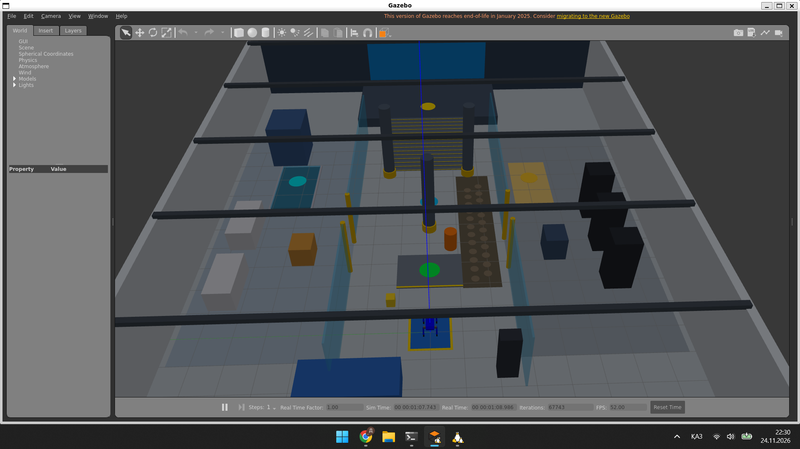
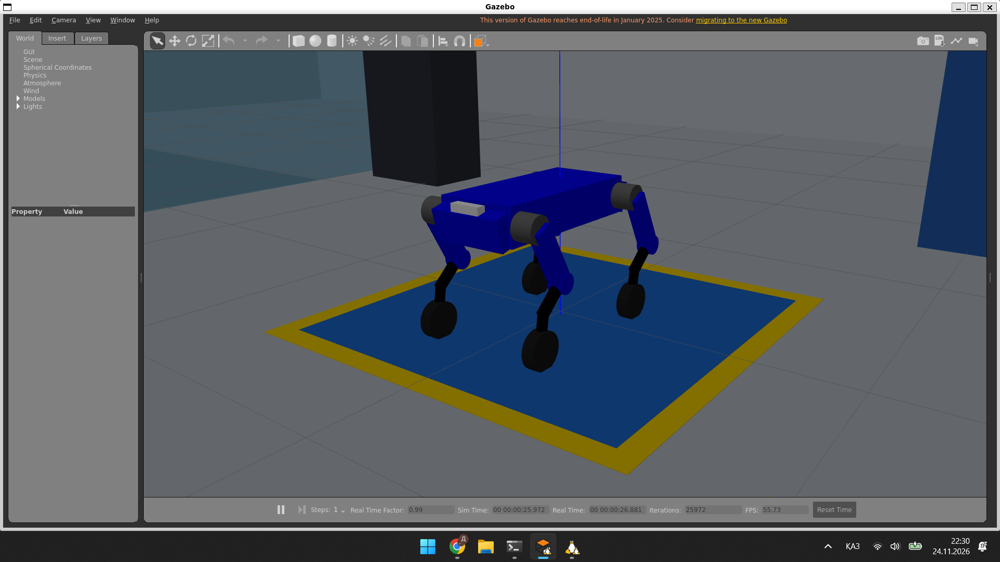
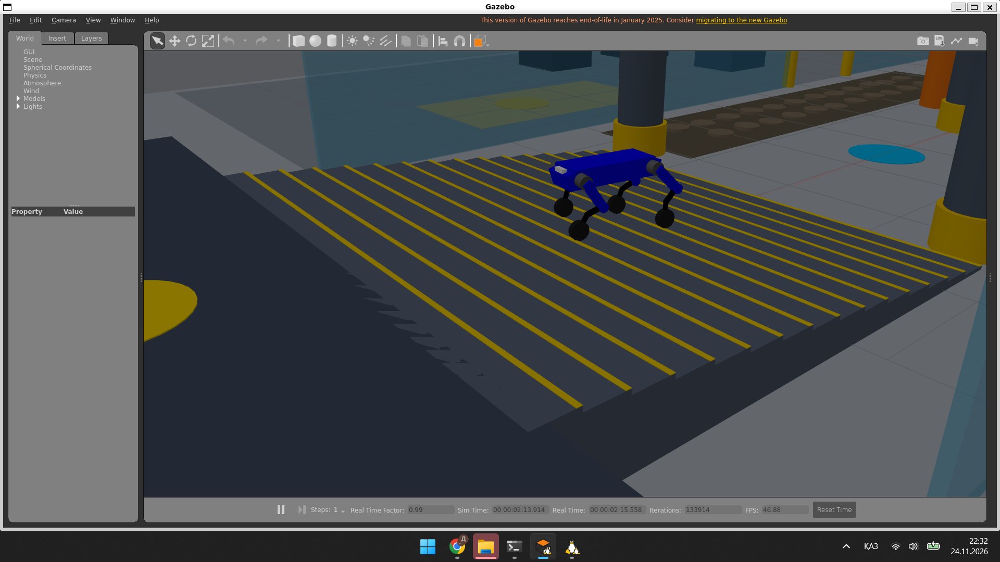
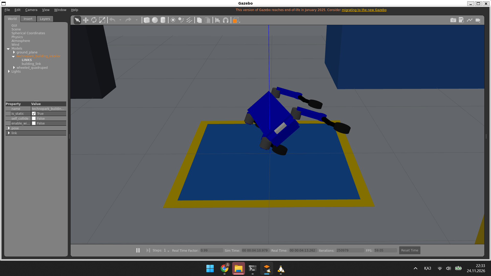
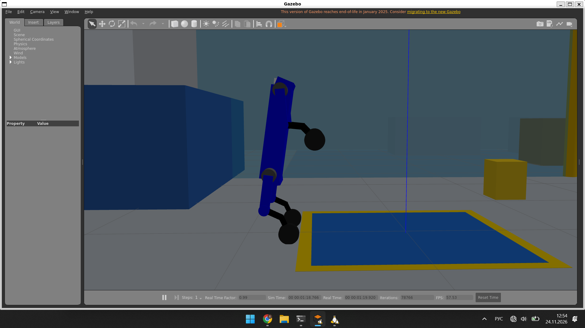
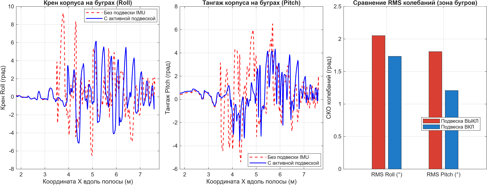
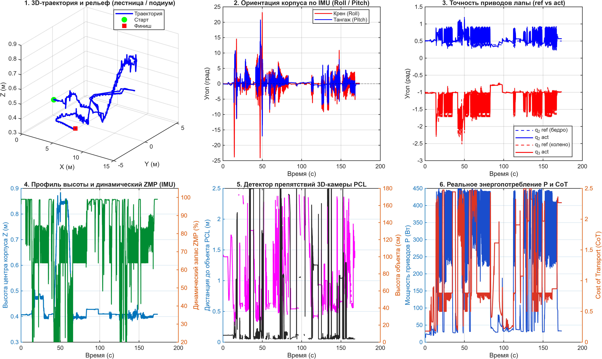
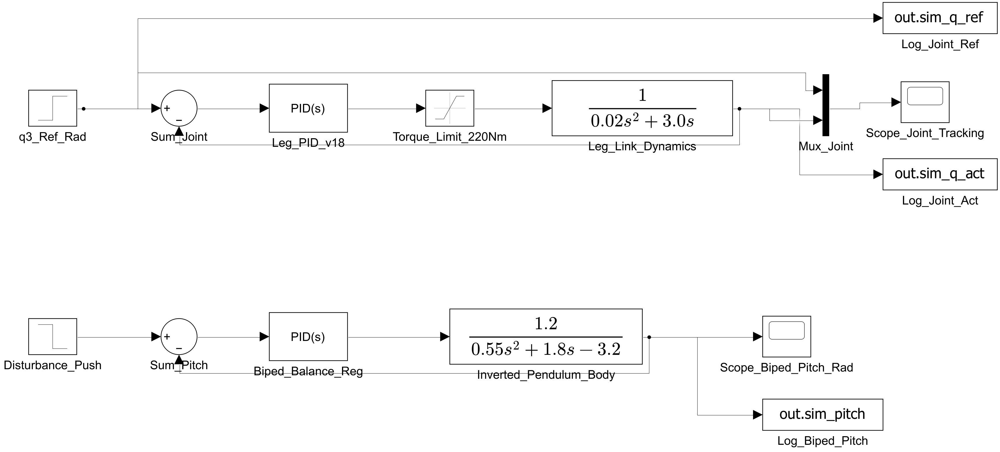
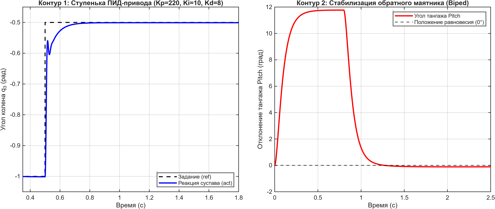

# Autonomous Wheeled Quadruped Robot (WQR)

[](https://docs.ros.org/en/humble/)
[-F58113)](https://classic.gazebosim.org/)
[](https://pointclouds.org/)
[](https://www.python.org/)
[](https://www.mathworks.com/)
[](LICENSE)

**Design, Control, 3D Perception, and Simulation of a 16-DOF Hybrid Wheeled-Legged Robot in ROS 2 Humble, Gazebo Classic, and MATLAB/Simulink.**

*Kazakh-German University (DKU), Almaty — Mechatronics Engineering Project (2026)*

> **[Full Technical Report (EN)](docs/Technical%20Report%20%E2%80%94%20WQR.pdf)** · **[Технический отчёт (RU)](docs/%D0%A2%D0%B5%D1%85%D0%BD%D0%B8%D1%87%D0%B5%D1%81%D0%BA%D0%B8%D0%B9%20%D0%BE%D1%82%D1%87%D0%B5%D1%82%20%E2%80%94%20WQR.pdf)** · **[Portfolio Brief (RU)](docs/%D0%9F%D0%BE%D1%80%D1%82%D1%84%D0%BE%D0%BB%D0%B8%D0%BE-%D0%B1%D1%80%D0%B8%D1%84%20%E2%80%94%20WQR.pdf)**



---

## Overview

The **Wheeled Quadruped Robot (WQR)** is a $23.6\,\text{kg}$, $16$-DOF hybrid mobile robotics simulation platform designed to operate across mixed indoor industrial environments—combining the speed and low Cost of Transport (CoT) of wheeled locomotion on flat floors with the rough-terrain traversability of legged locomotion over cylindrical bumps and a $15$-step staircase.

### Key Highlights & Verified Metrics

| Metric / Capability | Verified Result (WQR Build) |
| :--- | :--- |
| **Platform Configuration** | $23.6\,\text{kg}$ ($17$ links), $16$ actuated DOF ($12$ leg joints + $4$ hub-wheel motors) |
| **Dual-Rate Control Stack** | $1000\,\text{Hz}$ low-level torque PID (`ros2_control` / ODE) + $50\,\text{Hz}$ mission & gait controller |
| **IMU Active Suspension (A/B Test)** | **$-33.1\%$ RMS Pitch**, **$-15.5\%$ RMS Roll**, **$-33.4\%$ peak $|\phi| + |\theta|$** over $24$ bumps |
| **180° Self-Recovery** | **$100\%$ native ODE physics** ($0$ `set_gazebo_pose` calls), $4$-phase torque roll-over up to $\pm 220\,\text{N}\cdot\text{m}$ |
| **3D Vision & Autonomous Navigation** | C++/PCL $3$-sector obstacle detector, glass-wall filtering, dynamic A* + Pure Pursuit, **parking $\le 3.5\,\text{cm}$** |
| **Staircase Traversability** | Autonomous ascent & descent on a $15$-step staircase ($Z$: $0.40\,\text{m} \rightarrow \approx 0.86\,\text{m}$) |
| **Simulink Control Verification** | Leg PID settling $\approx 0.20\,\text{s}$ ($0\%$ overshoot); Biped inverted-pendulum recovery $\approx 0.45\,\text{s}$ |
| **Two-Wheel Static Calibration** | Biped ($80.2^\circ$) & Butterfly ($-78.0^\circ$) recalibrated across all $17$ URDF links (**CoM offset $< 2\,\text{mm}$**) |

---

## System Architecture

The software stack follows a modular three-tier ROS 2 Humble architecture that decouples high-frequency actuator dynamics, 3D point-cloud processing, and mission planning:

```text
┌──────────────────────────────────────────────────────────────────────────────┐
│                 HIGH-LEVEL MISSION CONTROL (50 Hz, Python 3)                 │
│                        wqr_mission_control.py                                │
│  • Global A* (0.25 m) + Chaikin Smoothing + Pure Pursuit + Precision Parking │
│  • Analytical Closed-Form Leg IK + Bézier Swing + 9-Mode Gait State Machine  │
│  • Sensor-Driven IMU Roughness Detector + Active Suspension + Operator GUI   │
│  • Physics-Based Power / CoT / ZMP Telemetry Logger -> telemetry_log.csv     │
└───────────────▲──────────────────────────────────────────────┬───────────────┘
                │ /odom, /imu/data, /joint_states, PCL metrics │ Trajectories &
                │                                              │ Wheel Velocities
┌───────────────┴──────────────────────┐   ┌───────────────────▼───────────────┐
│   MID-LEVEL 3D PERCEPTION (C++/PCL)  │   │  LOW-LEVEL PHYSICS & CONTROL      │
│         step_detector_node           │   │   (1000 Hz, Gazebo Classic/ODE)   │
│  • RGB-D Cloud (/camera/.../points)  │   │  • gazebo_ros2_control            │
│  • 3-Sector Distance & Height Filter │   │  • leg_controller (effort PID)    │
│  • Transparent-Glass Safeguards      │   │  • wheel_controller (velocity)    │
└──────────────────────────────────────┘   └───────────────────────────────────┘
                                                           │
                                                           ▼
                              ┌────────────────────────────────────────────────┐
                              │     OFFLINE ANALYSIS & CONTROL VERIFICATION    │
                              │              (MATLAB & Simulink)               │
                              │  • 6-Panel Dashboard & Terrain Energy Summary  │
                              │  • Spatially Aligned IMU Suspension A/B Script │
                              │  • Dual-Loop Control Model (ode4, 1000 Hz)     │
                              └────────────────────────────────────────────────┘
```

### ROS 2 Nodes & Interfaces

| Node / Module | Language | Subscribed Topics / Inputs | Published Topics / Outputs |
| :--- | :--- | :--- | :--- |
| `gzserver` + `gazebo_ros2_control` | C++ / ODE | `leg_controller`, `wheel_controller`, `/gazebo/set_entity_state` | `/joint_states`, `/odom` (`p3d`), `/imu/data`, `/camera/depth/color/points` |
| `robot_state_publisher` | C++ | `/joint_states`, `robot_description` (URDF) | `/tf`, `/tf_static` ($21$ frames) |
| `step_detector_node` | C++ (PCL) | `/camera/points`, `/camera/depth/color/points` | $3$-sector obstacle distance & elevation metrics (left / center / right) |
| `wqr_mission_control.py` | Python 3 | `/odom`, `/imu/data`, `/joint_states`, PCL metrics, GUI | $50\,\text{Hz}$ leg trajectories, wheel velocities, `telemetry_log.csv` |

---

## Mechanical Design & Physics Model (URDF / Xacro)

The chassis is modularly defined across `robot.urdf.xacro`, `leg.xacro`, and `sensors.xacro`:

| Parameter | Specification | Notes |
| :--- | :--- | :--- |
| **Total Mass** | $23.6\,\text{kg}$ | Chassis $10.0\,\text{kg}$ + $4 \times (0.8\,\text{kg hip} + 1.2\,\text{kg thigh} + 0.8\,\text{kg shank} + 0.6\,\text{kg wheel})$ |
| **Footprint & Link Lengths** | Wheelbase $0.50\,\text{m}$, Track $0.40\,\text{m}$ | $L_1 = L_2 = 0.20\,\text{m}$, wheel radius $R_w = 0.06\,\text{m}$ |
| **CoM Calibration (`base_link`)** | $(+0.038,\; 0.000,\; -0.120)\,\text{m}$ | Compensates rear-facing knee geometry for balanced front/rear axle load |
| **Nominal STAND Pose** | $[0.00,\; 0.50,\; -1.00]\,\text{rad} \times 4$ | Nominal chassis center height $Z = 0.406\,\text{m}$ |
| **Joint Limits** | Hip $\pm 1.25$, Thigh $\pm 2.20$, Knee $[-2.45, +0.40]\,\text{rad}$ | Analytical IK reach clamped at $D \le 0.395\,\text{m}$ (singularity protection) |
| **Leg PID (`effort`, $1000\,\text{Hz}$)** | $K_p = 220$, $K_i = 10$, $K_d = 8$, $\pm 220\,\text{N}\cdot\text{m}$ | Uniform torque-PID gains across all $12$ leg actuators |
| **ODE Contact Solutions** | Anisotropic friction ($\mu_1 = 0.28$, $\mu_2 = 1.15$) | Smooth $360^\circ$ spot turns + encoder parking brake ($\omega_{\text{cmd}} = -2.5\Delta\theta$) |

<p align="center">
  
  
</p>

---

## Locomotion Modes & Control Algorithms

The $50\,\text{Hz}$ finite-state controller implements $9$ locomotion and posture modes with cubic Hermite (`smoothstep`) posture blending and automatic sensor-driven gait switching (**AUTO-GAIT**):

| Mode | Trigger | Core Mechanism | Physics Basis |
| :--- | :--- | :--- | :--- |
| **Wheeled** | Auto / Manual | High-speed differential driving on flat floors & water ford (water: $+2.4\,\text{cm}$ clearance, $0.72\times$ speed) | $100\%$ ODE physics |
| **Crawl** | Auto (sand) / Manual | Statically stable `RL -> FL -> RR -> FR` gait with CoM triangle shift and swing-wheel zeroing | $100\%$ ODE physics |
| **Trot** | Auto (IMU) / Manual | Diagonal dynamic trot (`FL+RR` / `FR+RL`) with Bézier foot lift over rough terrain | $100\%$ ODE physics |
| **Side Gait** | Manual (GUI) | Lateral stepping via hip abduction joints (`hip_joint`) | $100\%$ ODE physics |
| **Stair Climbing** | Auto (stairs) | Adaptive ascent/descent on $15$-step stairs using Bézier foot swing & IMU pitch leveling | ODE + ramp smoothing aid |
| **Active Suspension** | Background (always) | Real-time roll/pitch leveling via filtered IMU leg-length deltas ($1.7^\circ$ deadband) | $100\%$ ODE physics |
| **Self-Recovery $180^\circ$** | Button / Flip | $4$-phase torque roll-over (`PREP -> PUSH -> LAND -> STANDUP`) with wall-block reversal | $100\%$ ODE physics |
| **Biped** | Special Mode | Two-rear-wheel upright stance ($80.2^\circ$, $x_{rw} = +0.118\,\text{m}$, CoM offset $< 2\,\text{mm}$) | Hybrid pose + Simulink |
| **Butterfly** | Special Mode | Two-left-wheel lateral stance ($-78.0^\circ$ roll, $Z = 0.57\,\text{m}$, zero lateral slip) | Hybrid pose |

### Key Algorithmic Features

* **Closed-Form Analytical Leg IK (`leg_ik`):** Deterministic microsecond inverse kinematics avoiding iterative Jacobian drift and full-extension singularities ($D \le L_1 + L_2 - 0.005\,\text{m}$).
* **Sensor-Driven Roughness Detector (`update_imu_roughness`):** Computes a real-time vibration index from gyroscope rates ($|\omega_{\text{roll}}| + |\omega_{\text{pitch}}|$), vertical acceleration ($|a_z - 9.81|$), and excess tilt ($> 0.03\,\text{rad}$). Exceeding threshold $0.42$ anywhere on the map engages `TROT` with a $2.2\,\text{s}$ hold hysteresis.
* **Transparent-Glass Navigation Safeguards:** Real depth cameras (e.g., Intel RealSense D435i) see through transparent glass partitions. To prevent dynamic objects in adjacent halls from falsely sealing doorways on the A* map, the planner applies three safeguards: room-side validation (`_same_room_side()`), static doorpost exclusion, and progressive obstacle-radius fallback (`dyn_scale`: $1.0 \rightarrow 0.60 \rightarrow 0.0$).

<p align="center">
  
  
</p>

---

## Experimental Results & MATLAB/Simulink Verification

### 1. IMU Active Suspension A/B Benchmark

Two identical autonomous runs were executed along the $24$-bump track ($2\text{--}4\,\text{cm}$ rigid cylinders, $X \in [1.8,\; 7.8]\,\text{m}$): baseline with suspension disabled (`WQR_NO_SUSP=1`) vs. nominal run with IMU active suspension enabled.

| Metric (Bump Strip $X \in [1.8,\; 7.8]\,\text{m}$) | Suspension OFF | Suspension ON | Relative Improvement |
| :--- | :---: | :---: | :---: |
| **RMS Roll ($\phi$)** | $2.05^\circ$ | $1.73^\circ$ | **$-15.5\%$** |
| **RMS Pitch ($\theta$)** | $1.81^\circ$ | $1.21^\circ$ | **$-33.1\%$** |
| **Peak Combined Sway $|\phi| + |\theta|$** | $15.76^\circ$ | $10.50^\circ$ | **$-33.4\%$** |
| **Max Leg-Length Compensation** | $0.0\,\text{mm}$ | $13.6\,\text{mm}$ | Within leg stroke |



### 2. Integrated $170\,\text{s}$ Multi-Terrain Telemetry Dashboard

Real-time telemetry exported at $50\,\text{Hz}$ captures 3D elevation ($Z$: $0.40\,\text{m} \rightarrow \approx 0.86\,\text{m}$ on stairs), IMU roll/pitch, reference vs. actual joint angles, dynamic ZMP stability margin ($85\text{--}99\%$ during wheeled cruise), PCL obstacle distances, and physics-based electrical power ($20\text{--}45\,\text{W}$ flat cruise, software-capped at $450\,\text{W}$ and $\text{CoT} \le 2.5$).



### 3. Analytical Control-Loop Verification (Simulink, `ode4`, $1000\,\text{Hz}$)

Transfer-function control loops in `matlab/wqr_digital_twin.slx`:

$$G_{\text{leg}}(s) = \frac{1}{0.02s^2 + 3.0s}, \qquad G_{\text{pendulum}}(s) = \frac{1.2}{0.55s^2 + 1.8s - 3.2}$$

| Control Loop | Controller Parameters | Settling Time | Overshoot | Verified Dynamic Behavior |
| :--- | :--- | :---: | :---: | :--- |
| **Loop 1: Leg Joint ($q_3$)** | $K_p=220,\; K_i=10,\; K_d=8,\; N=100,\; \pm 220\,\text{N}\cdot\text{m}$ | $\approx 0.20\,\text{s}$ | $0\%$ | Saturation exit at $t \approx 0.52\,\text{s}$; zero steady-state error |
| **Loop 2: Biped Pendulum** | $K_p=22.0,\; K_i=2.0,\; K_d=4.5,\; N=50$ | $\approx 0.45\,\text{s}$ | $0\%$ | Aperiodic stabilization from $\approx 11.8^\circ$ back to $0^\circ$ |

<p align="center">
  
  
</p>

---

## Repository Structure

```text
wheeled_quadruped_ws/
├── README.md                              # Project overview & setup guide
├── start_all.sh                           # Process cleanup & full simulation launcher
├── docs/                                  # Technical reports, portfolio brief & figures
│   ├── wqr_technical_report_en.pdf
│   ├── wqr_technical_report_ru.pdf
│   ├── wqr_portfolio_brief_ru.pdf
│   └── images/
├── src/
│   ├── wheeled_quadruped_description/
│   │   ├── config/
│   │   │   └── ros2_controllers.yaml      # ros2_control config (leg PID 220/10/8)
│   │   ├── launch/
│   │   │   └── gazebo.launch.py           # Gazebo world, robot spawn & controllers
│   │   ├── scripts/
│   │   │   └── wqr_mission_control.py     # 50 Hz controller, A*, IK, IMU, GUI, CSV export
│   │   ├── urdf/
│   │   │   ├── robot.urdf.xacro           # Base chassis (10 kg, CoM offset) & 4-leg assembly
│   │   │   ├── leg.xacro                  # 3-DOF leg + hub wheel macro (mu1=0.28, mu2=1.15)
│   │   │   └── sensors.xacro              # RGB-D camera (86° FOV), IMU, p3d odometry
│   │   └── worlds/
│   │       └── obstacle_course.world      # Technopark course (stairs, bumps, water, sand)
│   └── wheeled_quadruped_vision/
│       └── src/
│           └── step_detector_node.cpp     # C++ 3-sector PCL point-cloud obstacle detector
└── matlab/
    ├── analyze_wqr_telemetry.m            # 6-panel dashboard & terrain summary generator
    ├── analyze_ab_suspension.m            # Spatially aligned IMU suspension A/B analysis
    ├── build_wqr_simulink.m               # Simulink model builder & transient runner
    └── wqr_digital_twin.slx               # Dual-loop analytical control model (ode4, 1000 Hz)
```

---

## Installation & Quick Start

### Prerequisites

* **OS:** Ubuntu 22.04 LTS (native or WSL2 with GUI support)
* **ROS 2:** Humble Hawksbill
* **Simulator & Packages:** Gazebo Classic 11, `gazebo_ros2_control`, `ros2_control`, `ros2_controllers`, `xacro`, `robot_state_publisher`, `pcl_conversions`, `libpcl-dev`
* **Python 3:** `numpy`, `tkinter`
* **Optional (Control & Telemetry Analysis):** MATLAB & Simulink (R2023b or newer)

Install ROS 2 dependencies:

```bash
sudo apt update && sudo apt install -y \
  ros-humble-gazebo-ros-pkgs \
  ros-humble-gazebo-ros2-control \
  ros-humble-ros2-control \
  ros-humble-ros2-controllers \
  ros-humble-xacro \
  ros-humble-pcl-conversions \
  ros-humble-pcl-ros \
  libpcl-dev \
  python3-tk python3-numpy
```

### Build Workspace

```bash
git clone https://github.com/user15648915/WQR.git wheeled_quadruped_ws
cd wheeled_quadruped_ws
source /opt/ros/humble/setup.bash
colcon build --symlink-install
source install/setup.bash
```

### Launch Full Simulation

Use the automated launcher script (cleans up residual Gazebo processes and starts Gazebo, `ros2_control`, C++/PCL perception, and the operator GUI):

```bash
chmod +x start_all.sh
./start_all.sh
```

Or launch nodes individually in separate terminals:

```bash
# Terminal 1 — Gazebo Classic, URDF spawn & ros2_control
ros2 launch wheeled_quadruped_description gazebo.launch.py

# Terminal 2 — C++ / PCL 3D obstacle detector
ros2 run wheeled_quadruped_vision step_detector_node

# Terminal 3 — 50 Hz mission controller & WQR Control Panel GUI
python3 src/wheeled_quadruped_description/scripts/wqr_mission_control.py
```

### Running the IMU Active Suspension A/B Benchmark

To reproduce the baseline run with active suspension disabled:

```bash
WQR_NO_SUSP=1 python3 src/wheeled_quadruped_description/scripts/wqr_mission_control.py
```

### MATLAB & Simulink Analysis

After exporting telemetry CSV files from the GUI panel, open MATLAB in `matlab/` and run:

```matlab
% 1. Generate 6-panel mission telemetry dashboard
analyze_wqr_telemetry

% 2. Run spatially aligned A/B suspension comparison (ab_susp_on.csv vs ab_susp_off.csv)
analyze_ab_suspension

% 3. Build and simulate the 1000 Hz dual-loop Simulink model
build_wqr_simulink
```

---

## Known Limitations & Future Work

Out of $10$ project engineering requirements, **$8$ are fully met under native ODE physics** and **$2$ are met with explicitly documented simulation assumptions**:

1. **Two-Wheel Stances (`Biped` & `Butterfly`):** Velocity-controlled `wheel_controller`, small wheel radius ($6\,\text{cm}$), and $50\,\text{Hz}$ Python latency prevent native LQR balance in Gazebo; inverted-pendulum stabilizability is proven in Simulink at $1000\,\text{Hz}$ while Gazebo uses hybrid pose stabilization with statically calibrated CoM ($< 2\,\text{mm}$).
2. **Staircase Smoothing Geometry:** All $15$ steps have active collision, assisted by an invisible support plane (`stair_solid_support`) beneath sharp nosings to prevent $6\,\text{cm}$ wheel snagging during minor gait-phase mismatches.
3. **Localization & Deformable Media:** Pose is read from noise-free `libgazebo_ros_p3d.so` (no SLAM drift), and water/sand zones emulate drag and rolling resistance ($c_{rr}$) via zone-triggered parameters rather than fluid/granular ODE physics.

### Roadmap

* [ ] Migrate four hub-wheel drives to `effort` (torque) interfaces and implement a $500\text{--}1000\,\text{Hz}$ C++ `ros2_control` LQR/MPC balance controller for pure physical `Biped`/`Butterfly` driving.
* [ ] Replace ideal `p3d` odometry with EKF sensor fusion (`robot_localization`) and 3D SLAM (`RTAB-Map` / `Nav2`).
* [ ] Export `robot.urdf.xacro` to **Simscape Multibody** for full 3D contact-force and structural load analysis.
* [ ] Transfer the ROS 2 stack to a scaled **Hardware-in-the-Loop (HIL)** prototype using QDD BLDC actuators (CAN bus), Jetson/x86 compute, and an Intel RealSense D435i camera.

---

## Authors

* **Dastan Zhalgasbay**
* **Bakytzhanuly Adilzhan**
* **Tazabay Kasym**

*Mechatronics Program, Kazakh-German University (DKU), Almaty, Kazakhstan — 2026.*

## License

This project is released under the [MIT License](LICENSE).
